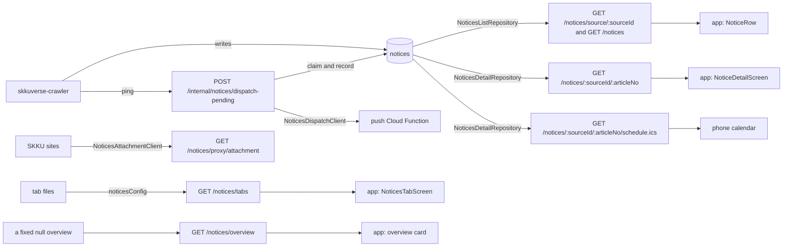

# Notices Architecture

> What `src/notices/` serves: the notice tabs, lists and details the crawler's documents feed, the overview stub the released app still calls, the attachment proxy, and the push dispatch the crawler's ping triggers. Read it before you change a notice route, a push field or the tab files.

## Context

The crawler owns the `notices` collection: it writes every document, and skkuverse-ai writes the summary fields through it. This server reads it, adds one read index, and writes only the five push fields of the dispatch. The tab files (`categories.json`, `sources.json`, `exclude-reasons.json`) are the crawler's codegen output, hash-locked and copied by the umbrella. The root holds the module file, the document type, the tab files' loader and what several flows share; `tabs/`, `list/`, `detail/`, `overview/` (a stub), `attachment/` and `dispatch/` are one flow each. `schedule/` parses the crawler's `schedule`, the timeline of the umbrella's notice brief decision, expands each item's occurrences and names its places through building, for `detail/`, which serves it as the timeline and exports those items as iCalendar. `blocks/` parses the crawler's `brief`, `audience` and `refs`, for `detail/`, which serves them beside the timeline. The server serves the stored summary fields, the `schedule` and the three blocks, and reads nothing else the crawler writes after a notice's first save.

| System | Quirk tag | Gives | Enters at |
| --- | --- | --- | --- |
| skkuverse-crawler | `skkuverse-crawler` | The notice documents with their `schedule`, `brief`, `audience` and `refs`, the unique article index, the tab files and the ping after a cycle that stored a new notice | `NoticeDoc`, `NoticesScheduleService`, `NoticesBlocksService`, `noticesConfig`, `NoticesDispatchController` |
| skkuverse-ai | `skkuverse-ai` | The summary fields, through the crawler | `selectRoleBadge` |
| MongoDB Atlas | `atlas` | The list and detail reads and the atomic dispatch claim | `NoticesListRepository`, `NoticesDetailRepository`, `NoticesDispatchRepository` |
| SKKU department sites | `skku`, `gnuboard` | Attachment files, some behind a board session or a hotlink check | `NoticesAttachmentClient` |
| axios | `axios` | The outbound calls of the proxy | `NoticesAttachmentClient` |
| The push Cloud Function | `push-function` | The fan-out to the notice's topics and its delivery counts, and a refusal of an empty title or body | `NoticesDispatchClient`, through `postToFcmFunction` |

## Glossary

| Term | Means | Derived from | Not |
| --- | --- | --- | --- |
| notice (`NoticeDoc`) | One crawled article on one board, as stored, its push fields included | the crawler's document | `NoticeDto` |
| source (`SourceConfig`) | One board the crawler reads, with its campus and availability | `sources.json` | a board (prose only) |
| category (`CategoryConfig`) | One tab definition, fixed to a source or a picker over several | `categories.json` | — |
| tab (`NoticeTab`) | A category as `GET /notices/tabs` serves it, in one language | `toTabsResponse` | `tabConfig` |
| list row (`NoticeListRow`) | The fields of a notice a list read loads | `LIST_PROJECTION` | — |
| list item (`NoticeListItem`) | A notice as a list cell shows it: flags, no body | `toListItem` | — |
| summary brief (`NoticeSummaryBrief`) | The list cell's one-liner and badge dates | `toSummaryBrief` | — |
| cursor (`CursorPayload`) | The last served row's date and id, the next page's start | `encodeCursor`, `decodeCursor` | — |
| page (`NoticePage`) | The served rows of a read of one more than the limit | `toNoticePage` | `FindResult` |
| detail row (`NoticeDetailRow`) | The fields of a notice the detail read loads | `DETAIL_PROJECTION` | — |
| detail (`NoticeDetail`) | One notice with its Markdown body, attachments, full summary and schedule | `toDetailItem` | — |
| full summary (`NoticeSummaryFull`) | The detail's summary, the ai's arrays passed through | `toSummaryFull` | — |
| schedule item (`ScheduleItem`) | One entry of the crawler's `schedule`: a title and status with a start, an end or both, its series (`rrule`), removed days (`exdate`) and stretches (`gaps`), extra occurrences (`rdate`), one level of parts, its place and its evidence | `storedSchedule` | — |
| occurrence | One stretch or moment of a schedule item in Asia/Seoul wall time, from `rrule + rdate - exdate - gaps`; the detail serves the first `MAX_SCHEDULE_OCCURRENCES` and counts the rest | `toOccurrences` | — |
| timeline minute | The wall minute an item sorts on: its end, else its start (for an item with more than one occurrence, the latest end among them; a series with no `until` has no last occurrence and sorts on the end of its first occurrence or of a later `rdate`), a point's `latest` day, else its date, and the end of a day with no time | `toTimelineMinute` | — |
| block (`NoticeBlocks`) | A notice's brief, audience and refs as the detail serves them, each `null` when the notice stores none, an empty one or one its schema refuses | `describeBlocks` | — |
| brief (`NoticeBrief`) | At most three bullets in the notice's own language, the stage's evidence left out | `storedBrief` | — |
| audience (`NoticeAudience`) | The programmes and enrolment statuses the notice names and the statuses it excludes, each value once; it filters nothing | `toAudience` | — |
| refs (`NoticeRefs`) | The links with their domain and the phone numbers and email addresses the crawler's regex stage found | `storedRefs` | — |
| notice schedule item (`NoticeScheduleItem`) | A schedule item as the detail serves it: as stored less its evidence, its place named by building, with its occurrences, in timeline order | `toScheduleItems` | — |
| calendar export | A notice's exportable schedule items as one iCalendar text, one event per item, its rules written as stored | `toCalendar` | — |
| cluster key (`clusterKeyOf`) | What the copies of one article share: the crawler's `dupOf`, or the notice's own `_id` while the crawler has not linked it; the list and the push each count an article once on it | `dupOf` | — |
| cluster member (`ClusterMember`) | A copy at or before the cursor of a list of several sources, read for its cluster key: an earlier page served its article | `CLUSTER_MEMBER_PROJECTION` | — |
| scanned row (`ScannedRow`) | A row of a list of several sources read only for its place in the list and its cluster key; the rows served are read again in full | `SCAN_PROJECTION` | — |
| shown copy | The copy of an article a list of several sources serves: the first in list order, which no crawl moves | `selectShownRows` | — |
| representative (`selectRepresentative`) | The copy a merged push links to | the group and its topics | — |
| claim window (`ClaimWindow`) | The age floor, lease cutoff and attempt cap of one claim | `toClaimWindow` | — |
| sweep summary (`SweepSummary`) | What one dispatch sweep claimed, sent and skipped | `NoticesDispatchService.sweepPending` | — |
| push payload (`NoticePushPayload`) | The data the Cloud Function relays to devices | `NoticesDispatchClient.sendPush` | — |
| push text (`PushText`) | A push's title and body: 📢 and the tab's name (the department board's own name for the department tab, the source's name when no one tab lists it) over the notice's original title, never model text and never empty, which the Cloud Function rejects | `toPushText` | — |

## Structure

What the app reads, from `skkuverse-app/packages/shared/src/notices/parser.ts` and the screens in `skkuverse-app/apps/mobile/src/features/notices/`:

| Field | App use |
| --- | --- |
| `/notices/tabs` `tabs` | The tab bar, the picker's sources with their availability and excluded-reason copy, and the default selections |
| list `summary` | The row's one-liner and its deadline badge (`formatDeadlineBadge`), from the stored summary fields alone |
| list `department`, `views`, `hasAttachments` | The row's chip, view count and attachment fallback line |
| list `nextCursor`, `hasMore` | Infinite scroll |
| detail `contentMarkdown`, `attachments` | The body, else the original page through `sourceUrl`, and the attachment list through the proxy |
| detail `summary` | The summary card |
| detail `schedule` | The timeline: each item's title, dates, occurrences and status, its parts as an agenda, and its place with a map button |
| detail `brief`, `audience`, `refs` | The next app version's bullets, audience table and contact rows |
| detail `author`, `views` | The header line |
| `/notices/overview` `overview` | The answer card above a search; the card hides on the null the stub always sends |

## Invariants

- Every notice read takes an inclusion projection (`LIST_PROJECTION`, `DETAIL_PROJECTION`, `CANDIDATE_PROJECTION`), so a field the crawler adds is never served by accident, and no list read loads a body.
- The list reads sort on date then `_id`, never `crawledAt`, which the crawler rewrites ([ADR 0007](../decisions/0007-notice-ordering-key.md)), are hinted to `FORCE_INDEX` and bounded by `HOT_READ_MAX_TIME_MS`; `NoticesListRepository` creates that index at boot.
- A list of two or more sources serves each article once, as its shown copy at that copy's place in the list (umbrella ADR `0001`). The order, the cursor and `hasMore` follow the served rows, so a page never repeats an article an earlier page served. A list of one source serves every copy.
- The list routes check their input in one schema, in the order the routes have always answered: the source, then the type, then the cursor. A search text that is empty, too long or holds a control character is dropped, never an error.
- `NoticesDispatchRepository` is the only writer of `pushedAt`, `pushAttempts`, `dispatchClaimedAt`, `pushError` and `pushSkippedReason`. A claim is atomic and a lease, so two replicas never push one notice twice ([ADR 0003](../decisions/0003-fcm-dispatch-cloud-function-claim-lease.md)), and the age gate is the notice's own KST date ([ADR 0008](../decisions/0008-dispatch-age-gate-on-publication-date.md)). A notice is claimable as soon as it is stored: no later stage of the crawler gates it, `aiSummaryAt` included. Each claim takes the newest claimable notice, by `date` then `_id`, so a backlog larger than one sweep sends the newest first. A group whose boards have no push topic (a `skku-main`-only article) is recorded as a skip: `pushedAt` set, so no claim takes it again, `pushSkippedReason: "no-topic"`, and no attempt counted.
- Cross-posted copies of one article, the notices of one cluster key, share one push to the union of their topics ([ADR 0005](../decisions/0005-notice-dispatch-content-group.md)), capped at `TOPIC_CAP`.
- A notice's stored `schedule` reaches a flow only through `NoticesScheduleService`, which parses it with `storedSchedule`, the zod mirror of the crawler's schema (`contracts/consumed/notice-schedule.schema.json`). `__tests__/contracts/notice-schedule.test.ts` judges each fixture by both and pins where they differ on purpose: the mirror strips an unknown key, ignores the crawler's `key` and `groupId`, takes any item id unique in the notice, and refuses an id another item or part repeats, a day no calendar has, a part with parts of its own and a series whose start or end is a range of days (`latest`), which the schedule stage never writes and a series cannot repeat. A notice with none, an empty list or a value the schema refuses, one in the earlier stored shape included, has no schedule (`null` on the detail, `NOT_FOUND` on the export); a refused one logs `notices.schedule.unparsed` with the notice id, at most once a minute per notice. A place id building names gets its name and building sheet; when building's read fails, every place keeps its words and the detail still answers. Every date and time is Asia/Seoul wall time, computed on day numbers and clock strings, never a `Date` in the host's zone. A series' cost does not grow with its `until`: past the head that holds its first occurrences in time order, it expands only the days an `exdate`, an `rdate` or a gap's edge marks and the last rule day of each stretch between them, and counts the other rule days from day numbers, so `omittedCount` and the timeline minute stay exact however far its `until` lies. The calendar export leaves out an item dated by a range of days (`latest`), keys each event's `UID` on the cluster key and the item id, and writes the stored rules with no cap; the item-to-iCalendar table is in `docs/reference/notices-api.md`.
- A notice's stored `brief`, `audience` and `refs` reach a flow only through `NoticesBlocksService`, which parses each with the zod mirror of its stage's output (`storedBrief`, `storedAudience`, `storedRefs`) and serves content only: the evidence a stage keeps (a bullet's quotes, the title's question, the audience quotes, the run record) and any field a later study adds are stripped at the parse. A block that is absent, null, empty or refused is `null` on the detail, and a refused one logs `notices.block.unparsed` with the block and the notice id, at most once a minute per notice and block. The `brief` parses only with a `brief-2` version and at most three bullets, so the brief of the earlier pipeline that old documents still carry is refused. The audience serves each value once, and the server filters no notice by it.
- The tab files are parsed at import by `noticesConfig`, and a bad file stops the boot with `notices.tabconfig.invalid`.
- An attachment request reaches only what `OUTBOUND_POLICY` allows for `notice-attachment`, on every hop ([ADR 0023](../decisions/0023-perimeter-ports.md)), and a type not known safe inline is served inside the sandbox CSP.
- The overview route reads no notice, writes nothing and calls no other service: every valid query gets a null overview with reason `unavailable`, and only a bad query fails, with `INVALID_PARAMS` or `INVALID_SOURCE_ID`.

## Open questions

- Notice reads are typed, not parsed per read ([ADR 0010](../decisions/0010-server-architecture.md), data access): `NoticeDoc` carries the crawler's `CONTRACT` tag, and the list and detail reads are reasoned entries in `__tests__/architecture/exemptions/repository-reads.json`. The crawler's exported document type replaces the hand-written one.
- `notices.topics.ts` has no role suffix because it reads the loaded categories itself; it joins a `.rules` file once it takes them as an argument.
- A list read whose hinted index is missing answers a server error.

## Related

- [Notices API](../reference/notices-api.md): the routes field by field, and the design notes
- [ADR 0003](../decisions/0003-fcm-dispatch-cloud-function-claim-lease.md): the dispatch claim lease
- [ADR 0005](../decisions/0005-notice-dispatch-content-group.md): one push per cross-posted article
- [ADR 0007](../decisions/0007-notice-ordering-key.md): the list's sort key
- [ADR 0010](../decisions/0010-server-architecture.md): the module shape
